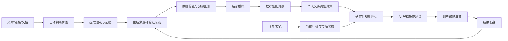

# AI-Trader Copilot 新应用蓝图

状态：`Draft v0.1`  
日期：2026-10-23  
用途：作为后续独立 Git 仓库的自包含需求与实现基线。

## 产品一句话

AI-Trader Copilot 是一个面向个人投资者的 Web 端 AI 交易决策辅助系统：它持续学习文章，自动判断内容价值，把可研究的观点转化为有证据、可验证、可回滚的交易规则，并结合行情、持仓与风险偏好给出当前操作建议。

它不是文章管理后台、通用回测平台或自动下单机器人。

## 已冻结的 v1 边界

- 市场：A 股。
- 频率：日线，收盘后分析，下一交易日执行假设。
- 用户：单用户、个人使用。
- 交互：Web 是唯一用户入口。
- AI：允许使用外部 LLM API；LLM 负责理解和解释，不负责确定性计算。
- 交易：用户做最终决策；v1 不连接券商、不自动下单。
- 自动化：系统自动处理常规研究工作，用户只处理风险偏好、重大规则启用和最终交易。
- 演进：规则、能力、模型与数据适配器均可版本化升级；安全内核保持稳定。

## 文档导航

1. [产品需求](docs/01-product-requirements.md)：目标、范围、用户任务、功能和非功能需求。
2. [产品体验与 UI](docs/02-product-ux.md)：三入口信息架构、极简设置和交互验收。
3. [系统架构](docs/03-system-architecture.md)：模块边界、运行方式、技术选型和关键流程。
4. [领域与数据模型](docs/04-domain-and-data-model.md)：核心实体、状态机、约束和审计链。
5. [AI 研究与持续进化](docs/05-ai-research-and-evolution.md)：文章筛选、模糊概念量化、自动研究和升级机制。
6. [行情、回测与性能](docs/06-market-data-backtesting-performance.md)：时点安全、分级回测、缓存和硬件要求。
7. [开发与交付计划](docs/07-development-plan.md)：纵向切片、阶段依赖和 10～14 周 MVP 计划。
8. [验收与质量门禁](docs/08-acceptance-and-quality-gates.md)：产品、AI、量化、UX、性能和发布门禁。
9. [部署、运维与安全](docs/09-deployment-operations-security.md)：本地部署、任务调度、监控、备份和密钥安全。
10. [决策、风险与待定项](docs/10-decisions-risks-and-open-items.md)：已经冻结的决定、允许延后的选择和风险控制。
11. [新仓库启动说明](docs/11-new-repository-bootstrap.md)：将本目录迁移为独立仓库时的目录、首批任务和保护规则。

## 核心业务闭环

## 设计原则

1. 结论先于过程：先告诉用户现在该关注什么，再按需展开证据。
2. 人只处理例外：普通文章、重复内容、低价值观点和失败规则由系统自动处理。
3. 模糊不是错误：模糊概念进入自动研究流程，不直接伪装成精确规则。
4. AI 不做计算：所有指标、信号、仓位、回测和风险判断由确定性程序执行。
5. 可以拒绝建议：数据不足或规则不适用时，系统明确输出“暂不建议操作”。
6. 每项变化可追溯：建议能回到规则、验证结果、文章证据和数据版本。
7. 演进必须可控：先离线验证，再后台模拟，再经确认启用，随时能够回滚。
8. 默认即可使用：首次设置不超过 3 分钟，日常不要求用户维护技术参数。

## 文档使用方式

- 当前阶段：本目录只承载新应用设计，不修改或依赖现有应用代码。
- 新仓库建立后：将本目录内容复制到新仓库根目录，再按启动说明建立工程骨架。
- 开发中：任何功能变更先修改对应需求和验收条款，再修改实现。
- 冲突优先级：产品边界与安全约束 > 验收门禁 > 架构建议 > 技术实现偏好。

