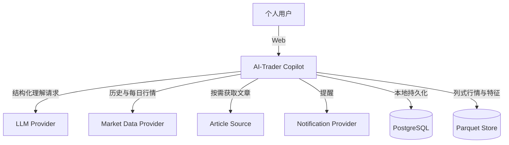
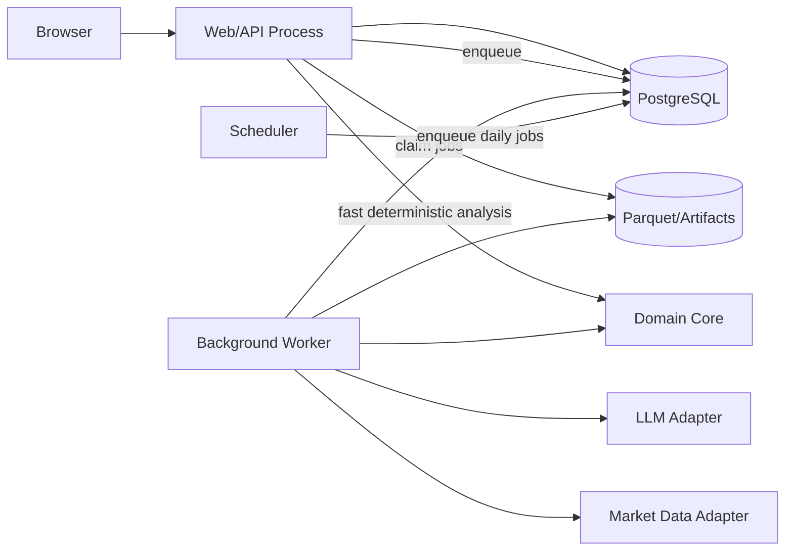
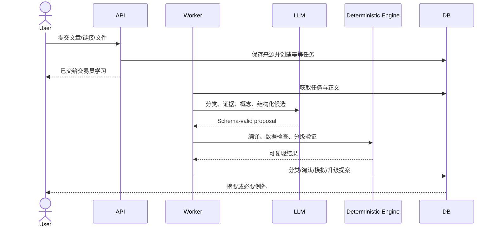
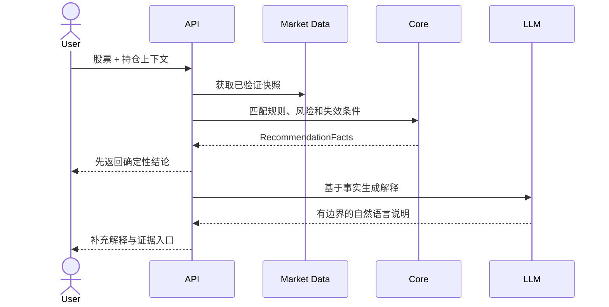

# 系统架构设计

状态：`Draft v0.1`

## 1. 架构目标

- 用一个模块化单体承载 MVP，避免过早拆分微服务。
- 日常交互与重型研究任务隔离，回测不能拖慢 Web。
- LLM、行情源、文章源和通知通道可以替换。
- 领域逻辑与 HTTP、数据库 ORM、供应商 SDK 解耦。
- 一种业务行为只有一条正式执行路径。
- 任何建议都可以复现到同一数据、规则和引擎版本。

## 2. 推荐技术基线

| 层 | 推荐 | 原因 |
|---|---|---|
| Web | React + TypeScript | 生态成熟，适合响应式 Web 和渐进披露交互 |
| API | Python + FastAPI + Pydantic | 适合结构化 AI 输出、数据任务和领域接口 |
| 业务数据库 | PostgreSQL | 事务、版本、审计和后台任务状态 |
| 行情分析存储 | Parquet + DuckDB/Polars | 列式扫描、压缩、单机高效回测 |
| 后台任务 | PostgreSQL 任务表 + 独立 Worker | MVP 无需额外队列基础设施，支持恢复和审计 |
| 缓存 | 进程缓存 + 持久化结果缓存 | 首先解决重复计算，不急于引入 Redis |
| LLM | Provider Adapter + 结构化输出 | 可切换供应商并隔离 SDK |
| 部署 | Docker Compose 或本机进程 | 单机可运行，未来可平滑迁移服务器 |

具体库可以在技术验证后替换，但接口边界不能由供应商 SDK 决定。

## 3. 系统上下文



外部服务失败时，系统必须显示真实降级状态；禁止伪造成功或静默使用过期数据。

## 4. 运行组件



进程职责：

- Web/API：身份、输入校验、查询、轻量确定性分析和任务提交。
- Worker：文章处理、数据同步、特征计算、回测、模拟、报告和复盘。
- Scheduler：收盘后任务、重试、规则监控和周期报告。
- Domain Core：规则、风险、资格判断、状态机和不可变约束。

## 5. 模块边界

### 5.1 `profile`

交易周期、风险偏好、仓位上限、提醒设置。输出可执行风险政策，不包含页面逻辑。

### 5.2 `sources`

文章输入、内容规范化、指纹、来源元数据和获取结果。文章适配器只能返回统一 `SourceDocument`。

### 5.3 `research`

文章价值判断、证据提取、知识声明、概念识别、候选量化方案和冲突分析。

### 5.4 `rules`

规则 DSL、编译、版本、状态机、适用环境和组合成交易员规则集。

### 5.5 `market_data`

数据需求、供应商适配器、原始数据落地、规范化、公司行为、交易日历、质量和可用时间。

### 5.6 `backtesting`

分级验证、信号生成、执行模型、成本、指标、样本外和滚动验证。不得依赖 LLM。

### 5.7 `analysis`

股票快照、持仓上下文、规则匹配、风险优先级、建议事实和解释请求。

### 5.8 `evolution`

后台模拟、规则健康、升级提案、暂停、回滚和能力版本评测。

### 5.9 `notifications`

日摘要、周报告、风险提醒和去重。只接收业务事件，不查询供应商原始状态。

### 5.10 `operations`

持久化任务队列、租约、幂等键、调度、健康检查和运维事件。

## 6. 依赖规则

```text
Web/API ─┐
Worker ──┼──> Application Services ──> Domain Core
Scheduler┘              │
                        └──> Ports ──> Adapters
                                      ├─ PostgreSQL
                                      ├─ Parquet/DuckDB
                                      ├─ LLM Provider
                                      └─ Data/Article/Notification Provider
```

- Domain Core 不导入 FastAPI、SQLAlchemy、LLM SDK 或行情 SDK。
- Adapter 不能绕过 Application Service 修改领域状态。
- 前端不直接理解后台任务阶段，只消费面向用户的业务状态。
- 回测和在线分析必须调用相同的规则编译与信号逻辑。
- 风险政策是所有建议输出前的最后强制门。

## 7. 关键业务路径

### 7.1 文章研究路径



### 7.2 股票分析路径



LLM 超时不能阻止确定性结论显示；系统应显示“解释暂不可用”，不得改用无依据文本。

## 8. 规则 DSL 与执行

规则 DSL 必须是受限声明式结构，而不是任意 Python 或自然语言。至少包含：

- `universe`：标的范围和排除条件。
- `regime`：适用市场状态。
- `inputs`：字段、频率、窗口、可用时间。
- `entry`、`hold`、`exit`、`invalidate`：布尔表达式。
- `risk`：仓位上限、止损、流动性约束。
- `execution`：信号产生与可执行时间、成本模型。
- `evidence_refs`：证据引用。

编译过程：Schema 校验 → 类型检查 → 数据依赖解析 → 时间安全检查 → 执行计划。失败即停止，不自动猜测字段。

## 9. 后台任务模型

MVP 使用 PostgreSQL 持久化任务队列：

- Worker 通过行锁和租约领取任务。
- 每个任务有幂等键、尝试次数、下一次执行时间和结构化错误。
- 崩溃或租约过期后可重新领取。
- 外部接口使用指数退避和抖动，永久错误不得无限重试。
- 业务状态与任务状态分开；任务成功不等于规则通过。
- 用户看到“学习中、无需处理、需要处理、暂不可用”，不看到队列状态。

## 10. 数据与制品边界

PostgreSQL 保存：

- 用户设置、来源元数据、证据、知识、规则和版本。
- 验证摘要、建议、复盘、任务、例外和审计事件。

Parquet/制品目录保存：

- 规范化行情分区、特征分区、可复现回测明细和报告制品。
- 每个制品有内容校验和、Schema 版本、生成器版本和时间范围。

禁止提交到 Git：原始文章、行情数据、数据库文件、API 密钥、个人持仓和生成缓存。

## 11. 演进能力

可替换接口：

- `LLMProvider`
- `MarketDataProvider`
- `ArticleSourceAdapter`
- `NotificationProvider`
- `RuleEvaluator`
- `CapabilityModule`

每个能力版本包含输入/输出契约、评测集版本、结果和生效区间。更换模型或提示词必须先运行回归评测，不能直接覆盖线上版本。

## 12. 架构决策原则

- 在性能证据出现前不拆微服务。
- 在任务队列表现不足前不引入 Kafka 等基础设施。
- 在单机列式引擎无法满足日线数据前不建设分布式计算。
- 在供应商确定前冻结 Adapter 契约，不让业务模型带供应商字段。
- 先打通一条真实纵向路径，再扩展文章类型、指标或策略数量。

