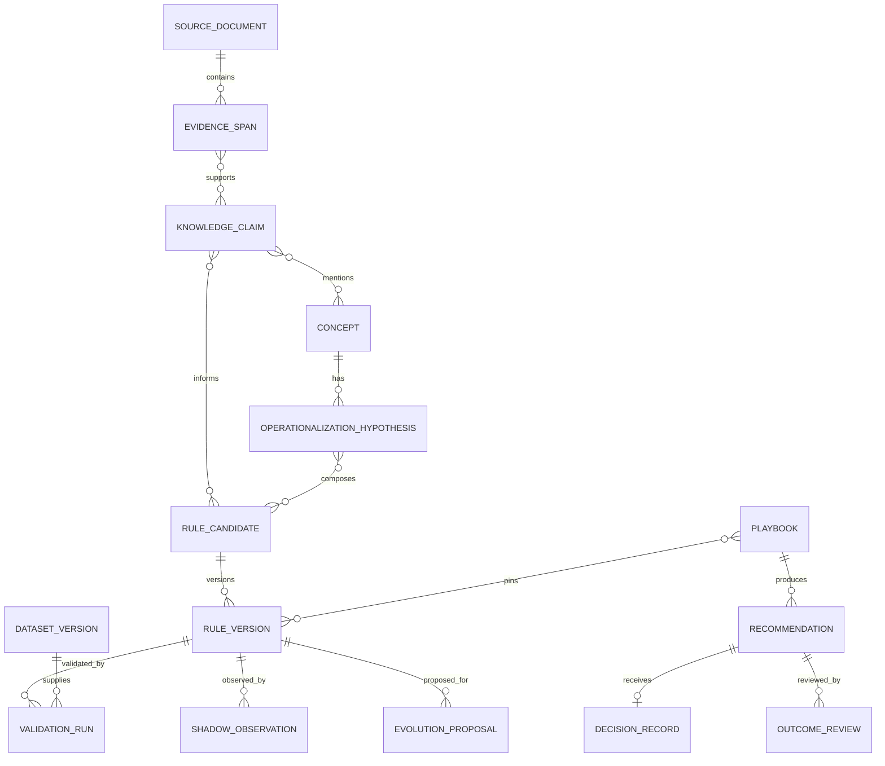

# 领域与数据模型

状态：`Draft v0.1`

## 1. 建模原则

- 原始事实、AI 推断、确定性计算和用户决定必须分开保存。
- 所有正式规则、能力、数据集和建议都有不可变版本引用。
- 状态变化通过领域命令完成，不允许直接改状态字符串。
- 删除采用可审计归档；已用于建议的版本不得物理删除。
- 所有时间使用带时区时间戳；交易日使用明确市场日历。

## 2. 核心聚合

### 2.1 用户与风险

`UserProfile`

- `id`
- `market`
- `holding_horizon`
- `risk_level`
- `single_position_limit`
- `notification_policy`
- `created_at` / `updated_at`

`RiskPolicyVersion`

- 从用户选择生成的具体风险边界。
- 包含生效时间、来源设置和变更摘要。
- 建议必须引用当时生效的版本。

### 2.2 来源与证据

`SourceDocument`

- 来源类型、标题、作者、URL、发布时间、获取时间。
- 原始内容位置、规范化正文、语言、内容指纹。
- 获取状态、解析质量和版权/保存策略。

`EvidenceSpan`

- 所属文档、原文起止位置、原文片段哈希。
- 上下文片段、提取模型版本和置信信息。
- 证据只能引用已保存且可重新定位的原文。

`KnowledgeClaim`

- 规范化观点、声明类型、适用范围和证据集合。
- 状态：支持、冲突、无法验证、仅背景。
- AI 生成的声明必须明确标记为推断。

### 2.3 概念与可操作化

`Concept`

- 原始词语，例如“放量”“强势”“重要压力位”。
- 上下文含义、可观察性判断和已知同义概念。

`OperationalizationHypothesis`

- 对概念的一种受限量化解释。
- 输入字段、公式、窗口、参数范围和语义理由。
- 所需数据、可能偏差和适用环境。
- 状态：草案、不可执行、待数据、待验证、淘汰、可用。

同一概念允许多个假设；系统不得直接把概念与单个公式永久绑定。

### 2.4 规则

`RuleCandidate`

- 从一个或多个知识声明形成的研究对象。
- 保存假设组合、预期机制和证据引用。

`RuleVersion`

- 不可变 DSL、编译器版本、数据需求和风险要求。
- 父版本、变更原因和生成方式。
- 状态：`draft → compilable → validating → rejected | shadow → proposed → active → paused → retired`。

`Playbook`

- 用户当前的“交易员规则集”。
- 包含固定版本的规则引用和组合优先级。
- 发布新版本时保留旧版本并记录生效区间。

### 2.5 数据与验证

`DataRequirement`

- 字段、频率、市场、起止时间、最早可用时间。
- 覆盖率、质量、复权、公司行为和来源要求。

`DatasetVersion`

- 供应商、拉取时间、规范化 Schema、内容校验和。
- 覆盖范围、质量报告和可用时间政策。

`ValidationRun`

- 规则版本、数据集版本、引擎版本和运行配置。
- 训练、验证、样本外区间和市场环境切片。
- 结果摘要、失败原因和制品引用。

`ShadowObservation`

- 某规则在不影响正式建议时产生的实时模拟信号。
- 保存信号时点、随后结果和偏离原因。

### 2.6 分析与建议

`MarketSnapshot`

- 标的、交易日、价格状态、市场环境和数据新鲜度。
- 仅包含当时可获得的数据。

`PositionSnapshot`

- 股票、数量或仓位、成本、建仓时间和记录来源。
- 每次分析保存快照，后续修改不改变历史建议。

`Recommendation`

- 股票、动作类别、有效期和数据截止时间。
- 触发条件、失效条件、风险、事实列表和解释文本。
- Playbook、规则、风险政策、数据和解释模型版本。
- 状态：生成、过期、撤销；历史记录不可覆写。

`DecisionRecord`

- 用户是否执行、执行比例、时间和可选备注。
- 未记录不等于未执行。

`OutcomeReview`

- 后续行情、规则预期、实际结果、风险事件和归因。
- 只生成演进证据，不自动改写历史建议。

### 2.7 演进与例外

`CapabilityVersion`

- 能力名称、输入/输出契约、实现版本、提示词或模型引用。
- 评测集、评测结果、生效和停用时间。

`EvolutionProposal`

- 目标规则或能力、候选版本、证据、验证结果和影响摘要。
- 是否改变风险边界、推荐动作和回滚目标。

`ExceptionItem`

- 用户可理解的问题、推荐选项、影响、优先级和截止时间。
- 相同根因使用去重键合并。
- 解决、过期或系统自动恢复后关闭。

## 3. 关系概览



## 4. 关键状态机

### 4.1 文章处理

```text
received → normalized → triaged
                       ├─ knowledge_only
                       ├─ duplicate_merged
                       ├─ waiting_for_data
                       ├─ archived
                       └─ researching → completed | failed_retryable | failed_terminal
```

失败是文章处理状态，不允许把没有完成的任务显示为已学习。

### 4.2 规则生命周期

```text
draft
  → compilable
  → validating
  ├─ rejected
  └─ shadow
       ├─ rejected
       └─ proposed
            ├─ shadow
            └─ active → paused → active | retired
```

- `active` 只能来自用户确认的 `proposed`。
- 风险或数据完整性失败可以自动把 `active` 变为 `paused`。
- 重新启用必须重新满足当前数据与验证门禁。

### 4.3 建议生命周期

```text
generated → expired
         └→ revoked
```

建议生成后不可改写；新行情产生新建议。若发现数据错误，旧建议标记 `revoked` 并记录原因。

## 5. 强制不变量

1. 正式建议必须引用一个已发布 Playbook 版本。
2. Playbook 中只能包含 `active` 的不可变 RuleVersion。
3. RuleVersion 必须至少有一个可重新定位的证据，或明确标记为系统风险先验。
4. 回测数据的 `available_at` 必须不晚于信号时点。
5. 数据覆盖、质量、粒度或时间安全失败时，验证和建议必须阻断。
6. LLM 输出在 Schema、证据和领域验证通过前不能成为领域事实。
7. 同一建议的确定性事实和自然语言解释分别保存。
8. 用户风险政策可以否决策略信号，策略不能放宽风险政策。
9. 所有状态转移记录操作者、原因、旧状态、新状态和时间。
10. 正式规则和建议不得依赖只存在于开发者机器的临时数据。

## 6. 时间语义

每个数据值至少区分：

- `event_time`：市场事件发生时间。
- `published_at`：信息发布或供应商标记时间。
- `available_at`：系统在当时最早能够使用的时间。
- `ingested_at`：实际进入系统的时间。

回测决策只能使用 `available_at <= decision_time` 的信息。日线策略默认在收盘后生成信号，下一交易日按执行模型成交。

## 7. 保留与隐私

- API Key 只保存密文或操作系统密钥引用，不进入领域表和日志。
- 个人持仓和决策记录默认仅保存在用户部署环境。
- 原文保存遵守来源许可；不允许保存时仅保留引用、指纹和允许的证据片段。
- 审计、正式规则和建议至少保留到用户明确导出并删除。
- 原始行情和派生特征可以按版本和保留策略清理，但被正式验证引用的数据集必须可重建或留存校验制品。

