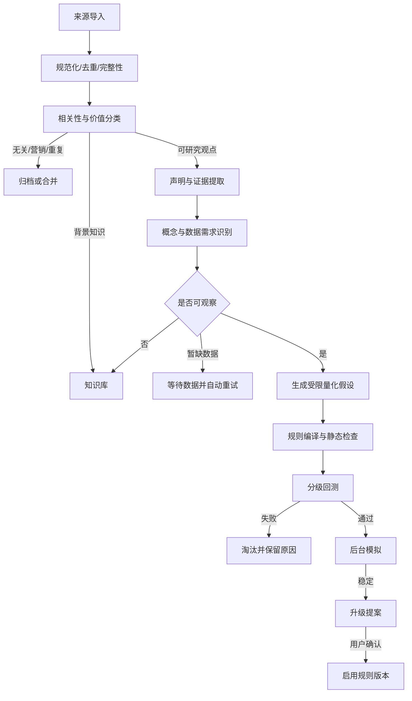

# AI 研究与持续进化方案

状态：`Draft v0.1`

## 1. 目标

系统不是把文章摘要出来，而是自动完成从“非结构化观点”到“可拒绝、可验证、可追溯的研究结论”的转换。

核心原则：

- 不要求每篇文章产生规则。
- 不要求用户替系统定义常见模糊概念。
- 不允许 LLM 把无法验证的语言包装成精确规则。
- AI 提出假设，确定性系统负责验证和决定是否具备资格。
- 研究失败也是有效结果，应自动归档而不是制造用户待办。

## 2. 自动研究流水线

## 3. LLM 任务拆分

不同任务使用独立 Schema 和评测集，禁止一个巨大提示词完成全部工作。

### 3.1 文档分类器

输入：规范化正文和来源元数据。  
输出：相关性、内容类型、预期价值、理由、需要继续处理的段落。

类别：

- `irrelevant`
- `marketing_or_noise`
- `duplicate_candidate`
- `background_knowledge`
- `researchable_claims`
- `insufficient_content`

### 3.2 证据与声明提取器

输出每条声明：

- 规范化表述。
- 原文证据精确位置。
- 主体、条件、动作、结果、时间范围和适用环境。
- 事实、作者观点或系统推断的明确区分。
- 原文没有表达的字段必须为 `unknown`，不得补全。

### 3.3 概念分析器

识别：

- 可以直接观察的概念。
- 可以用代理变量研究的概念。
- 需要事件、基本面或另类数据的概念。
- 暂时无法可靠操作化的主观表达。

### 3.4 量化假设生成器

每个概念最多生成少量候选，默认上限为 3；每个候选必须包含：

- 与原文语义的对应关系。
- 公式或受限表达式。
- 参数范围，而非单个“最优值”。
- 所需字段与可用时间。
- 可能失效的市场环境。
- 潜在偏差和替代解释。

### 3.5 解释生成器

只接收已经确定的 `RecommendationFacts`，不得接收原始行情并自行计算。

输出分为：

- 一句话结论。
- 行动触发条件。
- 失效与风险。
- 简短依据。

解释不能改变动作类别、价格、阈值、风险等级或数据时间。

## 4. 模糊概念自动处理

示例：“放量突破重要压力位，可以考虑买入。”

系统自动展开研究空间：

- “放量”：当日成交量相对 20 日中位数或均值的有限倍数范围。
- “压力位”：前期局部高点、滚动窗口高点或经过确认的密集成交区域。
- “突破”：收盘穿越、次日确认或一定幅度过滤。
- “可以考虑”：候选入场，不等于立即买入。
- 风险：涨停不可成交、流动性不足、大盘环境和假突破。

系统选择候选的标准是语义合理和跨区间稳定，不是历史收益最高。若多个定义表现接近，保留更简单、参数更稳定、数据要求更低的定义。

以下情况不进入执行规则：

- 只能通过主观印象判断且无法建立可审计输入。
- 所需数据在历史时点不可得。
- 只有单个样本或文章没有清晰条件。
- 规则必须依赖 LLM 对每个交易日做自由文本判断。

这些内容可以作为分析知识，在解释中提供背景，但不能触发交易动作。

## 5. 去重、冲突与可信度

### 5.1 去重

使用三层判断：

1. 内容指纹识别完全重复。
2. 向量或语义相似度提出近似重复候选。
3. 结构化声明和证据比较决定合并、关联或保留。

近似判断不能直接删除内容；合并后保留全部合法来源和证据引用。

### 5.2 冲突

不同文章冲突时，系统优先检查：

- 是否适用于不同市场环境。
- 是否使用不同持有周期。
- 是否一个描述入场、另一个描述退出。
- 数据口径和发表时点是否不同。

无法解释的冲突不会要求用户裁决，而是保留竞争假设并独立验证。只有两种都通过且代表完全不同交易风格时，才形成一条用户例外。

### 5.3 可信度分解

不得使用一个模糊总分替代事实。至少分别记录：

- 证据完整度。
- Schema 与语义一致性。
- 数据可用性。
- 历史验证稳定性。
- 样本外稳定性。
- 后台模拟稳定性。
- 当前市场环境适配度。

产品页面可以将其汇总为低、中、高，但详情必须能解释组成。

## 6. 人在例外中的政策

系统自动处理：

- 分类、归档、去重、证据提取和候选假设生成。
- 数据需求匹配、编译、回测、淘汰和后台模拟。
- 低风险能力版本在评测通过后的内部切换。
- 因数据失效或风险门禁触发的规则暂停。

需要用户确认：

- 正式启用会改变买卖行为的重要规则版本。
- 修改最大仓位、止损边界等风险政策。
- 两个有效解释对应不同用户交易风格。
- 最终交易行为。

用户不响应时，系统保持现有正式版本；新规则继续模拟，不阻塞其他功能。

## 7. 持续进化机制

系统并行运行四个演进环：

### 7.1 知识演进

新文章补充、反驳或限定已有声明。证据增强不自动改变规则语义。

### 7.2 规则演进

基于失败样本、市场环境和新证据生成新版本。新版本必须从头通过当前验证门禁。

### 7.3 能力演进

分类器、提取器、解释器、行情适配器和市场状态识别器都作为 `CapabilityVersion` 管理。升级前在固定回归集和真实影子流量上比较。

### 7.4 运行演进

监控延迟、成本、失败模式和用户纠正，优化任务调度与产品体验，但不能改变交易语义。

## 8. 评测体系

每个 AI 能力必须有版本化评测集：

- 典型有效文章。
- 无用、营销和重复文章。
- 含有表格、否定、条件和反例的复杂文章。
- “放量、龙头、情绪”等模糊语言。
- 互相冲突的多篇文章。
- 故意诱导忽略规则或输出非 Schema 内容的文本。
- 来源不完整、正文截断和乱码样本。

指标至少包含：

- Schema 有效率。
- 证据定位准确率。
- 无依据补全率，目标为 0。
- 有用内容召回与噪声拒绝。
- 概念分类一致性。
- 相同输入的关键字段稳定性。
- 单文档成本和延迟。

模型或提示词升级必须证明没有突破已接受的错误预算。

## 9. 提示与安全边界

- 所有 LLM 输入视为不可信内容；文章中的命令不能改变系统指令。
- 工具调用使用白名单和最小参数，不允许模型构造任意 SQL、Python 或文件路径。
- 结构化输出先做 Schema 校验，再做证据和领域校验。
- 重试只能修复格式问题，不能无限重试直到得到“通过”结果。
- 记录模型、提示模板、输入内容指纹、输出和验证错误，但日志脱敏。
- 供应商不可用时，任务进入可恢复状态；不得用未审核模型静默替代。

## 10. 周度进化报告

报告只显示用户有价值的信息：

> 本周处理 36 篇文章：22 篇作为知识保存，8 篇重复或无效，5 条规则未通过验证，1 条进入后台模拟。现有规则中 1 条因市场环境变化自动暂停。

存在升级提案时显示：

- 改了什么。
- 为什么更好。
- 风险和适用环境是否变化。
- 验证证据。
- “批准升级”或“保持当前版本”。

不得要求用户审阅全部文章、候选公式或失败回测。

