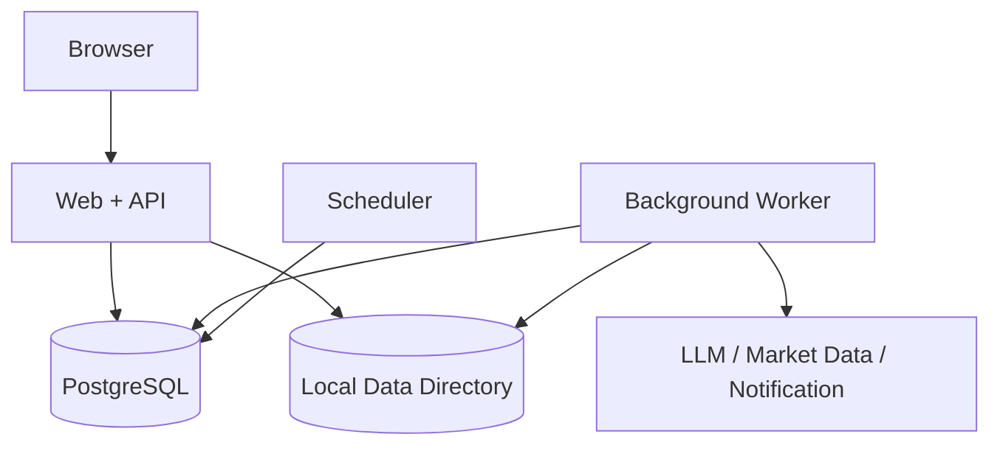

# 部署、运维与安全方案

状态：`Draft v0.1`

## 1. 部署目标

- 普通个人电脑能够长期运行日线版本。
- 重型任务后台执行，不影响日常分析。
- 外部服务失败、进程重启或机器断电后可以恢复。
- 用户可以备份并迁移到另一台机器。
- 本地部署与未来单机云部署使用同一组件边界。

## 2. MVP 部署拓扑

推荐提供两种启动方式：

- 开发：本机进程 + 本机 PostgreSQL。
- 个人部署：Docker Compose 管理 Web/API、Worker、Scheduler 和 PostgreSQL，行情制品使用挂载目录。

浏览器是唯一业务入口；命令行只用于安装、迁移、备份和故障修复。

## 3. 资源控制

默认适配 8 核、16 GB、100 GB SSD：

- Web/API 保留独立进程和连接池。
- Worker 默认并发不超过可用 CPU 的一半，可配置上限。
- 完整回测仅在无高优先级分析任务时启动。
- 进程内存超过软上限后停止领取新任务；超过硬上限时安全退出并由进程管理器重启。
- 磁盘剩余低于 15% 时停止生成可重建的非关键制品并发出提醒。
- 日线同步、特征增量和市场扫描按交易日历调度。

## 4. 日常调度

默认时序可配置，但业务语义固定：

1. 收盘数据供应商确认完成后同步行情。
2. 运行质量、覆盖和可用时间检查。
3. 增量更新特征。
4. 评估正式规则、持仓风险和候选股票。
5. 生成“今天”缓存和必要通知。
6. 低优先级运行文章研究、完整回测和后台模拟。
7. 周末生成规则健康与进化报告。

数据未通过检查时停止第 3～5 步，显示清晰状态并自动重试。

## 5. 健康与可观测性

### 5.1 用户健康状态

设置页只显示：

- 行情数据：正常 / 更新中 / 需要处理。
- AI 服务：正常 / 暂不可用 / 需要配置。
- 后台研究：正常 / 排队中 / 需要处理。
- 最近成功更新时间。

### 5.2 运维指标

- API 延迟、错误率和请求量。
- Worker 队列长度、最老任务年龄、重试和永久失败。
- LLM 调用延迟、Schema 失败、成本和限流。
- 行情覆盖、新鲜度、异常值和供应商修订。
- 回测耗时、缓存命中、CPU、内存和磁盘。
- 建议拒绝率、规则自动暂停和例外数量。

日志使用关联 ID 串联请求、任务和领域事件，但不向普通 UI 暴露。

## 6. 故障处理

| 故障 | 系统行为 |
|---|---|
| LLM 超时 | 保留任务并退避重试；已计算的股票事实仍可显示，解释标记不可用 |
| 行情源失败 | 不生成新建议；继续显示上次结果及明确过期状态 |
| Worker 崩溃 | 租约过期后重新领取，依靠幂等键防止重复结果 |
| 数据质量失败 | 阻断受影响的回测和建议，自动重拉或等待人工处理供应商问题 |
| 磁盘不足 | 停止非关键研究和新制品，保护数据库与正式结果 |
| 数据库不可用 | Web 显示服务暂不可用，不返回缓存伪成功 |
| 通知失败 | 建议仍保存在系统，通知重试并去重 |

## 7. 密钥与隐私

- 首选环境变量、Docker Secret 或操作系统安全存储。
- 若必须在应用内保存 API Key，使用主密钥加密并只显示掩码。
- 密钥不进入 Git、数据库备份明文、日志、错误追踪或 LLM 输入。
- 持仓、成本、交易记录和建议默认不发送给 LLM；解释器只接收最小化事实。
- 用户可以查看将发送给外部 AI 的数据类别。
- 提供数据导出和彻底删除流程。

## 8. 输入与供应链安全

- 上传文件按 MIME、扩展名、大小和解压后大小验证。
- 文件名不能决定服务器路径，解析器运行在资源受限环境。
- 抓取链接禁止访问本地网络、云元数据地址和非允许协议。
- 文章内容视为不可信文本，不能改变系统指令和工具权限。
- LLM 工具使用白名单，不允许任意命令、SQL 或代码执行。
- 前后端依赖锁版本并进行漏洞扫描；升级经过测试环境。

## 9. 备份与恢复

备份至少包含：

- PostgreSQL 逻辑备份。
- 配置和加密密钥的独立安全备份说明。
- 不可重建或已经被正式结果引用的制品清单。
- 数据目录 Manifest 和校验和。

默认策略建议：

- 每日增量、每周完整备份。
- 保留最近 7 个日备份和 4 个周备份。
- 每个发布阶段至少完成一次在空环境中的恢复演练。
- 可重建行情和特征不必全部进入高频备份，但重建步骤必须确定。

## 10. 升级与回滚

- 数据库迁移按顺序、可测试、可回滚或提供前滚修复。
- 应用升级前自动检查磁盘、备份、Schema 和 Worker 空闲状态。
- Worker 与 API 在滚动升级期间只处理兼容任务版本。
- 规则和能力版本独立于代码版本；回滚应用不能静默改变正式 Playbook。
- 升级失败时恢复应用和 Schema，并验证最近正式建议仍可读取。

## 11. 成本控制

- LLM 先用轻量模型分类，只有可研究内容进入更强模型。
- 对规范化内容指纹和提示模板版本缓存结果。
- 相同文章和相同任务不重复调用。
- 设置每日调用、Token 和金额软硬预算。
- 达到软预算时延后非关键研究；达到硬预算时停止新 AI 任务但保留股票确定性分析。
- 周报告展示成本和处理量，不要求用户理解 Token 参数。

## 12. 运维验收

- 连续运行 7 天，无需人工清理任务。
- 模拟断网、LLM 限流、行情异常、Worker 崩溃和数据库重启后正确恢复。
- 完整回测期间 Web 仍满足延迟门禁。
- 备份能在另一空环境恢复。
- 日志与导出中找不到密钥和不必要的个人数据。

